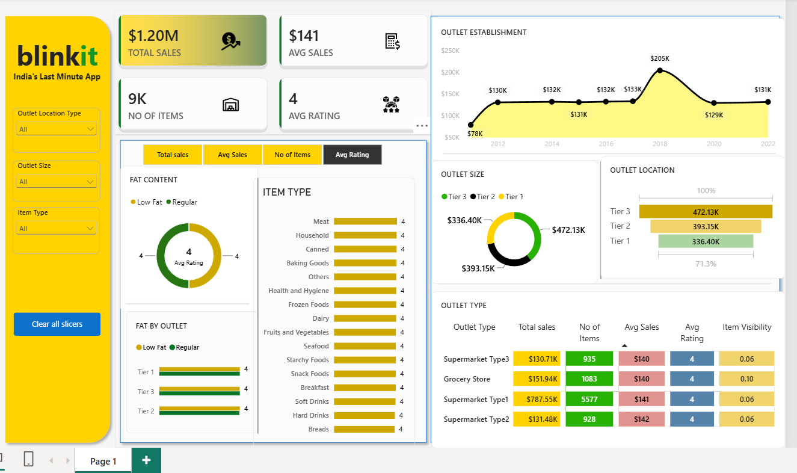

# 🛒 Blinkit Sales Analysis | SQL + Power BI

An end-to-end data analytics project that analyzes Blinkit (India's Last Minute App) sales data using **SQL** for querying and **Power BI** for an interactive dashboard.



## 📌 Project Overview
This project explores sales performance across items, outlets, locations and fat content to uncover trends that can support better business decisions.

## 🎯 Objectives
- Calculate key KPIs: Total Sales, Average Sales, Number of Items, Average Rating
- Analyze sales by fat content, item type, outlet size, outlet location and outlet type
- Track sales trends by outlet establishment year
- Build an interactive Power BI dashboard with slicers

## 🛠️ Tools Used
| Tool | Purpose |
|------|---------|
| SQL | Data cleaning and analysis |
| Power BI | Dashboard and visualization |
| Excel/CSV | Raw data source |
| Power Query | (Optional For Data Cleaning)

## 📊 Key KPIs
- **Total Sales:** $1.20M
- **Average Sales:** $141
- **Number of Items:** ~9K
- **Average Rating:** 4

## 🔍 Key Insights
- Low Fat items contribute the most sales (**$776.32K**) vs Regular (**$425.36K**).
- **Fruits and Vegetables** and **Snack Foods** are the top-selling item types (~$0.18M each).
- **Tier 3** locations generate the highest sales (**$472.13K**).
- **Supermarket Type1** leads outlet types with **$787.55K** in sales.
- Sales peaked for outlets established in **2018** (~$205K).

## 📁 Project Structure
```
├── data/        → Raw dataset
├── sql/         → SQL queries (cleaning, KPIs, analysis)
├── powerbi/     → Power BI (.pbix) file
└── dashboard/   → Dashboard PDF and preview image
```

## 🗄️ SQL Highlights
- Data cleaning (standardizing Fat Content values, handling NULLs)
- KPI calculations using aggregate functions
- Grouped analysis by item type, outlet and location
- Window functions / CTEs for deeper insights *(if used)*

## 📈 Dashboard Features
- KPI cards with toggle buttons (Total Sales, Avg Sales, No. of Items, Avg Rating)
- Slicers: Outlet Location Type, Outlet Size, Item Type
- Charts: Fat Content, Fat by Outlet, Item Type, Outlet Establishment, Outlet Size, Outlet Location
- Outlet Type table with conditional formatting

## ▶️ How to Use
1. Clone the repository
   `git clone https://github.com/<your-username>/blinkit-sales-analysis-sql-powerbi.git`
2. Run the SQL files in the `sql/` folder in order (01 → 03)
3. Open `powerbi/blinkit_sales_dashboard.pbix` in Power BI Desktop

## 👤 Author
Abhisht Pandey
